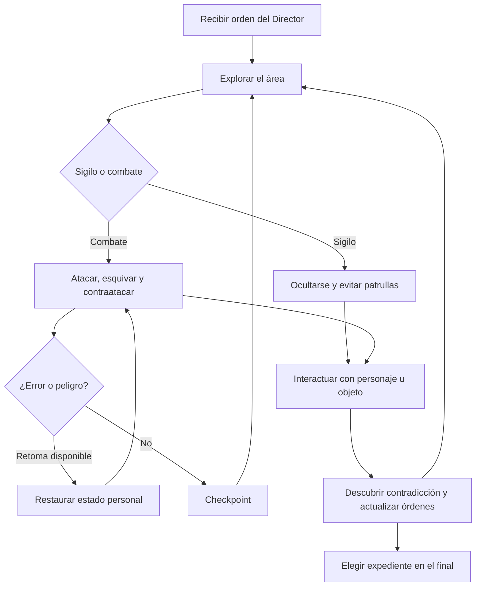

# 02 — Jugabilidad general, movimiento, sigilo e interacción

## Género y principios

Acción isométrica 3D con combate cuerpo a cuerpo, manipulación temporal, exploración breve, sigilo opcional y decisiones narrativas. Influencias mecánicas (sin copiar identidad ni assets):

- **Final Fight:** combos concisos y control de grupos.
- **Assassin's Creed:** parry, contraataques y eliminaciones contextuales.
- **Dark Souls:** ventanas de ataque, esquiva, lectura de enemigos, coste de resistencia.
- **No Rest for the Wicked:** posicionamiento isométrico y golpes comprometidos.

No se propone un soulslike completo, árbol de equipamiento, mundo abierto, parkour complejo ni oleadas interminables.

## Bucle principal

El jugador no solo ve que el Director manipula la historia: lleva a cabo acciones que contribuyen a esa manipulación o la desafían.

## Cámara y movimiento

- **Cámara:** fija/elevada isométrica, inicialmente Pitch -55° y Yaw 45° como referencia de prototipo.
- **Proyección:** ortográfica o perspectiva de ángulo similar; decidir según lectura del escenario.
- **Movimiento:** `WASD` relativo a la cámara.
- **Orientación del combate:** hacia el cursor del mouse, no automáticamente hacia la dirección de movimiento.
- **Espacio de combate:** pequeños callejones y plazas con cobertura; evitar que edificios oculten al personaje (recortes/transparencia si se necesita).
- **Meta:** el jugador debe leer telegráficas y rangos desde la cámara isométrica.

## Controles consolidados

| Entrada | Acción | Comentario |
|---|---|---|
| WASD | Desplazarse | Relativo a cámara |
| Mouse | Dirección del personaje/ataque | Apuntado isométrico |
| Clic izquierdo | Ataque ligero | Combo de hasta tres golpes |
| Clic derecho | Ataque fuerte | Carga opcional, no obligatoria |
| Espacio | Esquiva | Invulnerabilidad breve durante parte de la animación |
| Q | Parry / Contraorden | Exige sincronización |
| F | Corte de Fotograma | Interrumpe un objetivo temporalmente |
| R | Retoma | Vuelve hasta 5 segundos en el tiempo personal |
| E | Interactuar / remate | Elegir contexto prioritario |
| Ctrl | Agacharse | Menor detección, velocidad reducida |
| Tab | Checklist | Orden actual y progreso |
| Esc | Pausa | Menú |

**Versión preliminar desestimada:** R para rebobinar *todo el mundo* y Shift para correr como acción requerida. Correr puede añadirse si el diseño lo justifica.

## Sigilo

### Estados de los guardias

1. **Patrol:** recorre 2–3 puntos.
2. **Suspicious:** sospecha, gira o investiga última posición conocida.
3. **Chase:** persigue al protagonista si confirma la detección.
4. **Return:** vuelve a ruta tras perderlo.
5. **Combat:** participa en el enfrentamiento si el diseño del enemigo lo contempla.
6. **Stunned / Defeated:** aturdido (admite remate) y neutralizado. Lista completa en `EEnemyAIState` (`docs/plan/01_CONTRATOS_Y_PROPIEDAD.md`).

Un guardia dispone de campo de visión frontal y línea de visión bloqueable por paredes, cajas y barriles. El HUD puede mostrar un indicador de detección progresivo. Esconderse o salir del área de visión reduce la alerta.

### Cobertura y escondites

- **Cobertura pasiva:** obstáculos que bloquean la línea de visión (cajas, muros, esquinas).
- **Escondite interactivo:** armario o zona oscura; `E` entra/sale y limita otras acciones mientras está activo.
- **Agacharse:** reduce velocidad y visibilidad (o distancia de percepción), sujeto a ajuste.
- **Alternativa:** el jugador puede optar por combatir para despejar un acceso, con la salvedad de no matar a civiles.

### Ataques por sorpresa

Un ataque sigiloso desde una posición válida puede dejar a un enemigo común neutralizado. No requiere sistema avanzado de animaciones de asesinato: puede representarse con un derribo no letal y una animación contextual simple.

## Interacción

La misma acción `E` permite:

- Hablar con Jack u otros personajes.
- Abrir puertas o activar mecanismos.
- Entrar y salir de escondites.
- Examinar y recoger evidencias.
- Ejecutar remate contextual en un enemigo aturdido.
- Registrar uno de los dos expedientes finales.

Implementar con `BPI_Interactable` y priorización de objetivos cercanos. No ejecutar simultáneamente remate y uso de puerta si los dos son válidos en el mismo instante; mostrar nombre/acción activa al jugador.

## Jack como objetivo de escolta acotado

En lugar de un seguidor con IA general, utilizar puntos de avance predefinidos:

1. Espera en taller.
2. Jugador abre puerta lateral.
3. Se activa ruta de salida.
4. Jack avanza por tramos o cuando la zona es segura.
5. Alcanza refugio y queda oculto.

Esto evita una misión de escolta con pathfinding altamente impredecible. El jugador puede enfrentarse a enemigos o esquivarlos para habilitar el recorrido.

## Fallo, recuperación y checkpoints

- Ser detectado inicia persecución/combate (no es fallo inmediato, salvo que se decida lo contrario para una zona concreta).
- Si la salud del agente llega a cero, ofrecer **Retoma** si hay cargas y el contexto lo permite; en otro caso reiniciar desde checkpoint. La forma exacta de "ofrecer" está abierta (ver `AGENTS.md`).
- Los checkpoints restablecen cargas de Retoma (2) y pueden restaurar salud conforme al balance final.
- El bucle debe evitar reinicios largos: el propósito de Retoma es dejar experimentar con errores.
- Las elecciones narrativas importantes no admiten retroceso.

## Reglas sobre combate y sigilo

- No hacer que todos los enemigos ataquen a la vez cuando haya tres en pantalla.
- Dar espacio alrededor de la arena para esquivar y reposicionarse.
- Un enemigo común debe poder ser derrotado con un combo y uno o dos golpes adicionales.
- El combate debe recompensar lectura, no presionar el ataque sin observar.
- El uso de violencia autorizado por la agencia puede contraponerse con desviaciones no autorizadas mediante el aviso «CONTINUIDAD ALTERADA».
