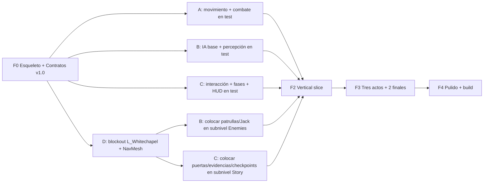

# 00 — Plan general de trabajo en paralelo (4 divisiones + agentes de IA)

> **Lectura obligatoria para las 4 personas y sus agentes.** Este documento define *cómo* trabajamos. El *qué* está en los documentos de diseño (`docs/01`–`docs/07`) y en el plan de cada división. Las interfaces compartidas están en [`01_CONTRATOS_Y_PROPIEDAD.md`](01_CONTRATOS_Y_PROPIEDAD.md).

## 1. La idea en una frase

**Cada persona es dueña de un conjunto de carpetas y solo edita lo suyo; las divisiones se comunican únicamente a través de contratos (enums, structs, interfaces y eventos) creados al principio y congelados.** En Unreal los `.uasset` y `.umap` son binarios: **Git no puede fusionarlos**. Si dos personas tocan el mismo asset, una de las dos pierde su trabajo. Por eso el plan evita conflictos por diseño, no por suerte.

## 2. Las cuatro divisiones

| División | Nombre | Resumen | Plan detallado | Persona |
|---|---|---|---|---|
| **A** | Agente | Jugador, cámara, input, combate, salud/resistencia, Corte de Fotograma, Retoma | [`A_AGENTE_COMBATE_TEMPORAL.md`](A_AGENTE_COMBATE_TEMPORAL.md) | _(nombre)_ |
| **B** | Oposición | Enemigos (Perseguidor, Interventor, Supervisor), IA, sigilo/detección, Jack | [`B_ENEMIGOS_IA_SIGILO.md`](B_ENEMIGOS_IA_SIGILO.md) | _(nombre)_ |
| **C** | Relato | Fases de historia, interacción, evidencias, diálogos, checklist, HUD, checkpoints, finales | [`C_NARRATIVA_INTERACCION_UI.md`](C_NARRATIVA_INTERACCION_UI.md) | _(nombre)_ |
| **D** | Mundo | Nivel Whitechapel, cámara/oclusión, arte, VFX, audio, iluminación, build final | [`D_MUNDO_ARTE_AUDIO_BUILD.md`](D_MUNDO_ARTE_AUDIO_BUILD.md) | _(nombre)_ |

### Rol transversal: Integrador

Una persona (recomendado: **D**, porque ya es dueña del mapa persistente y de la build) asume además:

- Crear el **esqueleto** del proyecto en la Fase 0 (sección 5).
- Ser la única persona que modifica `Content/CorteFinal/Core/`, `Config/`, el `.uproject` y los plugins.
- Revisar y fusionar PRs a `main`, y mantener `main` jugable.
- Aplicar cambios de contrato aprobados (sección 7).

Si el integrador no es D, anotarlo aquí: **Integrador = _(nombre)_**.

## 3. Decisiones que se cierran en el kickoff (antes de crear el proyecto)

**Actualización 2026-11-14:** el proyecto ya existe en `Unscripted/Unscripted.uproject`. Nombre definitivo **Unscripted**, UE **5.8.4**, plantilla **Top Down**, creación **Blueprint**. Todo contenido para el jugador debe estar en inglés (ver `AGENTS.md`). La instalación de cada integrante y la apertura del proyecto deben verificarse en el editor. La preparación actual puede realizarse bajo el rol excepcional de integrador autorizado por el usuario; el responsable permanente sigue pendiente de asignar.

Estas decisiones afectan a todos. Se toman juntos en los primeros minutos y se anotan aquí:

| # | Decisión | Recomendación | Decidido |
|---|---|---|---|
| D0.1 | Versión exacta de UE5 | Usar la misma instalación/versionado en los cuatro equipos. | **5.8.4**, confirmada por el usuario |
| D0.2 | Blueprint o Blueprint + C++ | C++ requiere una decisión posterior explícita. | **Blueprint** |
| D0.3 | Plantilla | Reutilizar el proyecto existente. | **Top Down**, variante por verificar |
| D0.4 | Herramienta de agente de cada persona | Claude Code, Codex, Cursor… da igual: todos leen `AGENTS.md`. | |
| D0.5 | Plugin de agente para Unreal (MCP) | Opcional y experimental. Solo si los 4 lo instalan igual; lo añade el integrador. | |
| D0.6 | Packs de assets externos (Fab, Mixamo, etc.) | Revisar las reglas de la jam sobre assets de terceros. D lleva `CREDITS.md`. | |
| D0.7 | Proyección de cámara (ortográfica o perspectiva) | Perspectiva con FOV bajo es menos problemática con sombras/Lumen. | |
| D0.8 | Duración y horarios de la jam | Rellenar la tabla de fases (sección 6). | |

## 4. Reglas de oro (para humanos y agentes)

1. **Solo editas tus carpetas.** La tabla de propiedad está en `01_CONTRATOS_Y_PROPIEDAD.md §2`. Abrir y *leer* assets ajenos está bien; **guardarlos no**. Si Unreal marca un asset ajeno como modificado (asterisco), **no lo guardes**: usa *Revert* o descarta al cerrar.
2. **Los contratos no se cambian por tu cuenta.** Si necesitas algo nuevo, sigue la sección 7.
3. **Cierra Unreal antes de `git pull`, `git checkout`, `git merge` o `git rebase`.** Actualizar binarios con el editor abierto corrompe referencias o hace que el editor reescriba los archivos viejos.
4. **No renombres ni muevas assets ajenos.** Renombrar crea *redirectors*. Solo el dueño mueve sus assets y luego ejecuta *Fix Up Redirectors* en su carpeta.
5. **Experimentos en tu carpeta de pruebas**, no en el mapa principal (`Maps/Test/L_Test_<División>`).
6. **`main` siempre abre y siempre se juega.** Nada se fusiona si hay errores de compilación de Blueprint.
7. **Integra pronto y en pequeño:** al menos **2 PR por persona y día**. Una rama que vive 2 días es una rama que va a romper algo.
8. **El repositorio NO debe estar dentro de OneDrive/Dropbox/Google Drive.** La sincronización bloquea archivos y corrompe `.uasset`/`Intermediate`. Clonar en una ruta corta, ej. `C:\Dev\CorteFinal` (las rutas largas también dan errores en Windows con UE).

## 5. Fase 0 — Esqueleto (lo hace el integrador, el resto prepara)

**Objetivo:** que, al terminar, existan *todos* los archivos compartidos y los "cascarones" de cada sistema, para que cada persona solo **rellene** sus propios assets y nunca necesite crear algo que otro también vaya a crear.

### 5.1 Integrador (orden recomendado)

1. Abrir el proyecto existente `Unscripted/Unscripted.uproject` con UE 5.8.4; verificar apertura y Play de la plantilla. No crear otro proyecto. Seguir también `02_ARRANQUE_F0.md`.
2. Verificar que `.gitignore` y `.gitattributes` del repo están en la raíz **antes del primer commit con `.uasset`**. Ejecutar `git lfs install` una vez.
3. Crear la estructura de carpetas de `01_CONTRATOS §2` (con un asset o `.gitkeep` en cada una).
4. Crear **todos los assets de `Core/`** (enums, structs, interfaces) con las firmas exactas de `01_CONTRATOS §3–§4`.
5. Crear los **cascarones** (Blueprints vacíos con la clase padre correcta y las funciones/dispatchers del contrato declarados, sin lógica) listados en `01_CONTRATOS §5`.
6. Añadir los componentes al `BP_PlayerCharacter` (Combat, Health, Temporal, Interaction, Stealth) y fijar `BP_GameMode` / `BP_GameState` / `BP_PlayerController` / `BP_HUD` en Project Settings.
7. Crear el mapa persistente `L_Whitechapel` y sus subniveles (`01_CONTRATOS §6`), y los mapas de prueba por división.
8. Configurar `Config/` (canales de colisión, mapa por defecto, Enhanced Input) según `01_CONTRATOS §7`.
9. Commit `[INT] Esqueleto v1.0`, push, avisar al equipo. **A partir de aquí el contrato es v1.0 y está congelado.**

Tiempo estimado: 2–3 horas. Los agentes pueden escribir scripts de Python del editor para crear carpetas y assets en lote (sección 8).

### 5.2 Resto del equipo mientras tanto

- Instalar la versión exacta de UE, Git LFS y clonar el repo **fuera de OneDrive**.
- Leer `README.md`, `AGENTS.md`, este documento, los contratos y su plan de división.
- Con su agente: desglosar su backlog de Fase 1 en pasos implementables y preparar los datos de texto (CSV de balance, diálogos).
- A y B: elegir fuentes de animación (Mannequin de UE5, Mixamo, packs de Fab). D: buscar packs de entorno victoriano y sonido; registrar licencias.

## 6. Fases y hitos

Las duraciones son **porcentajes del tiempo total de la jam**. Rellenar con fechas reales en el kickoff.

| Fase | % aprox. | Objetivo | Hito de salida (criterio verificable) | Fecha/hora |
|---|---|---|---|---|
| **F0 Esqueleto** | 5 % | Proyecto, contratos, cascarones, mapas | Los 4 abren `main` y ven sus cascarones sin errores | |
| **F1 Sistemas aislados** | 30 % | Cada división construye su núcleo en **su mapa de prueba** con dobles de prueba propios | Cada división demuestra su "mínimo F1" (ver su plan) | |
| **F2 Vertical slice** | 20 % | Todo junto en `L_Whitechapel` (blockout) con **un encuentro completo** | Un jugador: aparece, recibe órdenes, pelea con 2 Perseguidores usando combo/parry/Corte/Retoma, abre una puerta, el HUD y el checklist reaccionan, muere y reaparece en checkpoint | |
| **F3 Contenido** | 25 % | Tres actos jugables de principio a fin con ambos finales | Partida completa A→Final A y A→Final B sin tocar el editor. **Feature freeze**: no entran mecánicas nuevas | |
| **F4 Pulido y entrega** | 20 % | Balance, arte, audio, bugs, build | Build empaquetada probada en un PC que no sea el de desarrollo. **Code freeze** ~3 h antes de la entrega | |

### Ritual diario

- **Sync de 10 min** al empezar el día y a mitad de jornada: ¿qué terminé? ¿qué me bloquea? ¿necesito un cambio de contrato?
- **Ventanas de integración** (2 al día, a hora fija): todos fusionan lo terminado; el integrador abre `L_Whitechapel`, juega 2 minutos y confirma que `main` está sano.
- Cada persona actualiza la sección **Estado** de *su propio* archivo de división (nunca el de otro: evita conflictos incluso en Markdown).

### Dependencias entre divisiones (camino crítico)



Tras validar F0, nadie necesita esperar sistemas completos de otra división para F1: **cada división fabrica sus propios dobles de prueba** en su carpeta `Test/`. El blockout de D es necesario para colocar e integrar el contenido de B/C en el nivel compartido, no para sus pruebas aisladas.

## 7. Cambios de contrato (cómo pedir algo a otra división)

1. El que lo necesita escribe la petición en la sección **"Solicitudes de contrato"** de *su* archivo de división y avisa por el chat del equipo con el prefijo `[CONTRATO]`.
2. El dueño del asset afectado y el integrador la aceptan o proponen alternativa (objetivo: < 30 min).
3. **Cambios aditivos** (nueva función, nuevo valor de enum **al final**, nuevo evento): el dueño del asset lo añade y lo fusiona; se actualiza `01_CONTRATOS` y su versión menor (v1.1, v1.2…).
4. **Cambios destructivos** (renombrar, quitar, cambiar tipos de parámetros): solo con acuerdo de los afectados, en una ventana de integración, con todos habiendo fusionado antes. Evitar después de F2.
5. Mientras se aprueba, **no bloquearse**: simular el dato en el doble de prueba propio.

## 8. Trabajo con agentes de IA

### 8.1 Contexto que se le da al agente

Cada persona arranca cada sesión de su agente con este contexto (en este orden):

1. `AGENTS.md` (se carga solo en la mayoría de herramientas; `CLAUDE.md` lo importa para Claude Code).
2. `docs/plan/00_PLAN_GENERAL.md` y `docs/plan/01_CONTRATOS_Y_PROPIEDAD.md`.
3. Su archivo de división.
4. Los documentos de diseño que su archivo de división cita como fuente.

Cada plan de división incluye un **prompt de arranque** listo para pegar.

### 8.2 Lo que un agente puede y no puede hacer en Unreal

Un agente **no puede editar grafos de Blueprint (`.uasset`) escribiendo texto**. Formas efectivas de usarlo:

| Uso | Cómo | Bueno para |
|---|---|---|
| **Guía nodo a nodo** | El agente escribe la implementación del Blueprint paso a paso (variables, eventos, nodos y conexiones); la persona la construye en el editor | Toda la lógica Blueprint |
| **Revisión por capturas** | Pegar capturas del grafo o el log de *Output/Message Log*; el agente detecta errores | Depuración |
| **Datos en texto** | El agente genera **CSV/JSON** que se importan como **DataTables** (balance, diálogos, checklist). Texto = fusionable y revisable | Balance A/B, diálogos C |
| **Python del editor** | Scripts (plugin *Python Editor Script Plugin*) para crear carpetas, Input Actions, assets en lote, renombrados masivos | Fase 0, D (colocación/auditoría) |
| **C++ ligero** (si D0.2 lo aprueba) | Lógica pura en C++ (buffer de Retoma, coordinación de ataques, gestor de fases) expuesta a Blueprint. El texto C++ se fusiona bien en Git | A, B, C |
| **Plugin MCP para Unreal** (si D0.5) | El agente crea/modifica assets vía editor. Experimental: verificar siempre a mano | Opcional |

### 8.3 Reglas para los agentes (además de las de `AGENTS.md`)

- Una tarea del backlog por sesión, con su criterio de aceptación copiado al prompt.
- El agente **solo** crea/modifica archivos de texto en las rutas de su división (`docs/plan/<su archivo>`, `Scripts/<División>/`, `SourceData/<División>/`, `Source/` de su módulo si hay C++).
- Si el agente detecta que necesita un cambio de contrato o tocar algo ajeno, **para y lo propone** en "Solicitudes de contrato"; no lo hace.
- Si inventa algo no definido en el diseño, lo marca como **[PROPUESTA]** y lo anota en su archivo de división.
- No dar nada por implementado sin haberlo probado en el editor (el humano confirma).

## 9. Flujo de Git

### Ramas

- `main`: protegida; solo entra por PR (o por el integrador en ventanas de integración).
- Ramas cortas por división: `a/combo-ligero`, `b/percepcion`, `c/checklist`, `d/blockout`, `int/esqueleto`.
- Vida máxima recomendada de una rama: medio día.

### Ciclo de trabajo

```text
(cerrar Unreal)
git switch main && git pull
git switch -c a/parry
(abrir Unreal, trabajar SOLO en carpetas propias, guardar, cerrar Unreal)
git status            # ¿aparece algún archivo fuera de mis carpetas? -> revertirlo
git add <mis rutas>   # nunca "git add ." a ciegas
git commit -m "[A] Parry con ventana por AnimNotify"
git pull --rebase origin main
git push -u origin a/parry
(abrir PR con la plantilla; fusionar en la ventana de integración)
```

### Si aparece un conflicto en un `.uasset`/`.umap`

No se puede fusionar. Se elige la versión del **dueño** (`git checkout --theirs/--ours <archivo>`) y quien no es dueño rehace su cambio *a través del dueño*. Si pasa, es señal de que se rompió la regla 1: revisarlo en el sync.

### Bloqueos de Git LFS (para lo poco que es compartido)

Para los archivos con dueño único no hace falta. Para los compartidos (`Core/`, `L_Whitechapel` persistente, `BP_PlayerCharacter` si alguien más que A debe tocarlo excepcionalmente):

```text
git lfs lock Unscripted/Content/CorteFinal/Core/Enums/ECombatState.uasset
... editar, commit, push ...
git lfs unlock Unscripted/Content/CorteFinal/Core/Enums/ECombatState.uasset
git lfs locks          # ver quién tiene qué
```

**Cuota de LFS:** GitHub limita el almacenamiento y el ancho de banda LFS gratuitos. Revisarlo en *Settings → Billing* del dueño del repo y no subir assets fuente pesados (`.psd`, `.blend`, `.wav` sin comprimir enormes) si no hacen falta.

### Convenciones

- Mensajes de commit: `[A]`, `[B]`, `[C]`, `[D]`, `[INT]` + descripción en imperativo.
- PR: usar `.github/pull_request_template.md`.

## 10. Definición de "hecho" (para cualquier tarea)

- [ ] Funciona en el mapa de prueba de la división y, desde F2, en `L_Whitechapel`.
- [ ] 0 errores y 0 warnings de compilación en los Blueprints tocados.
- [ ] Valores ajustables en variables expuestas o DataTables, no "números mágicos" en nodos.
- [ ] Ninguna referencia a `Developers/` ni a assets de prueba desde contenido de juego.
- [ ] `git status` limpio de archivos ajenos.
- [ ] Tarea marcada en la sección Estado del archivo de división.
- [ ] Todo contenido visible o audible al jugador está en inglés, incluidos errores, prompts, imágenes con texto, documentos, créditos y audio hablado. Sin debug de desarrollo en la entrega.

## 11. Riesgos del proyecto y mitigación

| Riesgo | Mitigación |
|---|---|
| Dos personas guardan el mismo binario | Propiedad por carpetas + subniveles + regla 1 + revisión de `git status` |
| Versiones distintas de UE | D0.1 antes de crear el proyecto; comprobar *Help → About* |
| Repo dentro de OneDrive | Regla 8 |
| NavMesh/lighting ensucian el mapa persistente | NavMesh con generación en tiempo de ejecución y Lumen (sin luz horneada); solo D guarda el persistente (`01_CONTRATOS §6`) |
| El blockout cambia y descoloca actores de B/C | Layout "congelado" al terminar F2; desde ahí D solo cambia arte, no rutas jugables |
| Animaciones no sincronizan con parry/impacto | Ventanas por AnimNotify + valores en DataTable; probar desde F1 |
| Retoma teletransporta dentro de paredes | Validación de destino (ver `docs/04`) es parte del "hecho" de A |
| Alcance excesivo | Todo lo P2 (extensiones de `docs/07`) solo tras el hito F3 |
| La build empaquetada falla al final | D hace una build de prueba **al terminar F2**, no solo en F4 |
